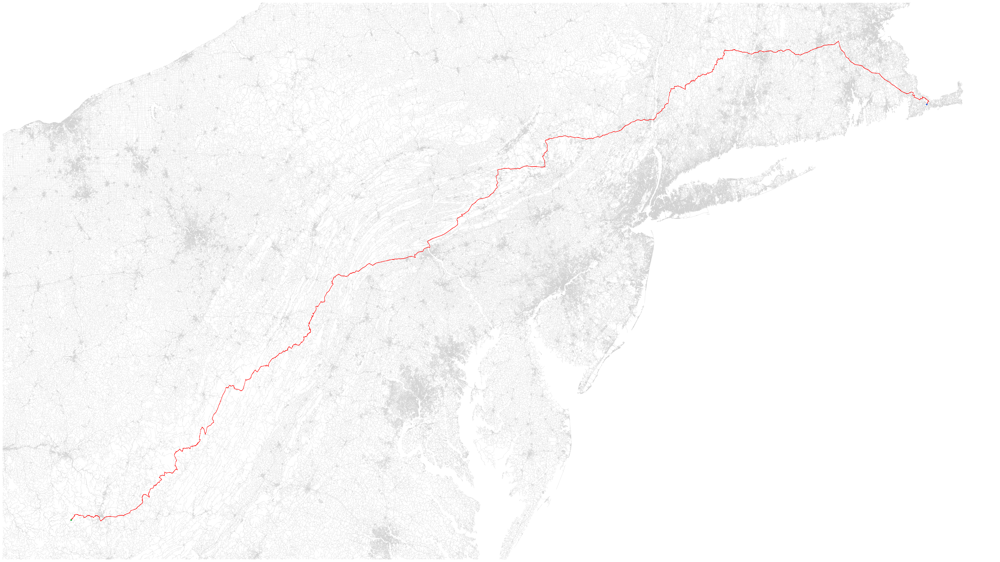

## GOAL:

- The initial goal was to implement the BFS algorithm without AI assistance, ensuring a correct implementation that met the requirements and expected behavior.

- AI (or superintelligence) was used only to help with data visualization and to understand the algorithm.

- No AI-generated code was used as a reference for the BFS implementation, and the only code created or modified by AI was the entirety of the tools.rs file.

## How to use (AI-generated explanation):

The program loads a DIMACS road graph, runs BFS between two nodes you type in, and writes a map of the path.

The main goal of this project is the BFS implementation. Loading a dataset was kept simple on purpose: the file paths are hardcoded in `src/main.rs` for practicality, not because the algorithm only works on one graph. The default pair is the full USA network:

- `dataset/USA-road-d.USA.gr` in `extract_dataset`
- `dataset/USA-road-d.USA.co` in the `load_coordinates` call

Any other distance graph from the same challenge works the same way. Download the matching **Distance graph** (`.gr`) and **Coordinates** (`.co`) from [the 9th DIMACS challenge](https://www.diag.uniroma1.it/challenge9/download.shtml), put both files in `dataset/`, and change those two declarations in `src/main.rs` so they point at the new pair. The `.gr` and the `.co` must be the same network (for example `USA-road-d.NY.gr` with `USA-road-d.NY.co`).

1. Place the chosen `.gr` and `.co` files in `dataset/` and, if they are not the USA pair above, update the two paths in `src/main.rs`.
2. From the project root, run:

```bash
cargo run --release
```

3. When prompted, enter a start node and an end node. Ids are **0-based** (the files are 1-based; the loader subtracts 1). The valid range is printed as `0` through `node count - 1`.
4. If a path exists, two files are written in the project root:
   - `path.png` — the path in red, start in green, end in blue, nearby roads in gray
   - `path.geojson` — open [geojson.io](https://geojson.io) and import the file to see the path on a map
5. The prompt repeats so you can try another pair. Stop the process with Ctrl+C.

If the two nodes are not connected, it prints `No path found between <start> and <end>` and asks again. A node id outside the graph returns the same message. Non-numeric input panics.


## Example:

Example of one search on `USA-road-d.USA`, from node `23000000` to node `8000000` (2895 nodes on the path). The start is green, the end is blue, the BFS path is red, and nearby roads are gray:

